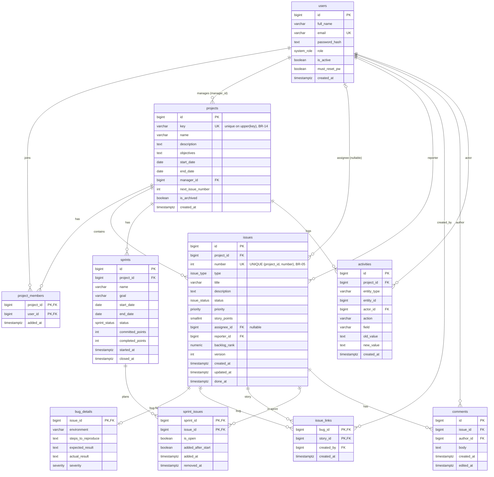

# DevTrack ER Diagram (10 tables, all columns)

Source: SRS v0.1, sections 5.1 and 5.2. Task: AGL-02.1. Version 2 (after Dev 2 review).

## Notes
- **BR-05:** `UNIQUE (project_id, number)` on `issues` makes issue keys unique per project (e.g. ECOM-101). The number comes from `projects.next_issue_number`, incremented under a row lock. Mermaid cannot draw a composite unique key, so `number` is marked UK with this note.
- **Assignee is optional:** `issues.assignee_id` is nullable, so the users side of "assignee" is zero-or-one. `reporter_id` is NOT NULL, so every issue has exactly one reporter.
- `activities.entity_id` has no foreign key: it points to an issue, sprint, project or comment depending on `entity_type`.
- `activities` is append-only (UPDATE and DELETE are revoked from the app user, BR-12).
- Assignment history is stored in `activities` (field = `assignee`), not in its own table.
- `projects.key` is unique case-insensitively through the index on `upper(key)` (BR-14).
